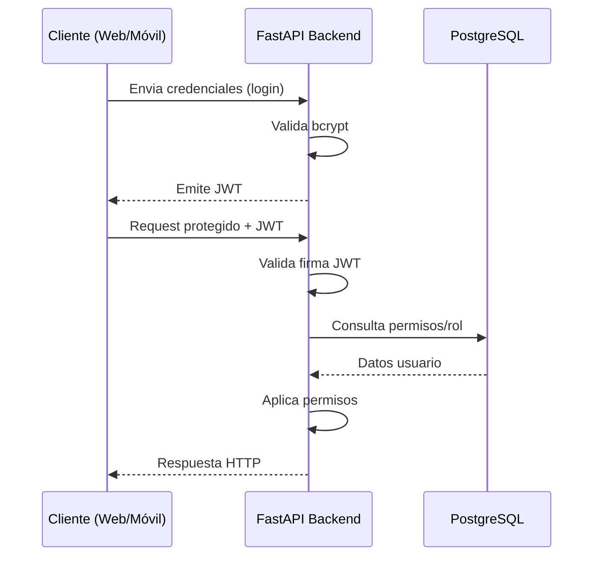

# Arquitectura - Enci Ventas

## Vision general

Enci Ventas es un MiniCRM comercial web. Recientemente ha sido migrado de Firebase/Firestore hacia una arquitectura de base de datos relacional (PostgreSQL) y autenticación propietaria mediante JWT.

## Stack tecnologico

| Capa | Tecnologia | Uso |
|------|------------|-----|
| Backend | FastAPI + Python 3.12+ | API REST, validaciones, permisos y Swagger controlado |
| Gestor de dependencias | uv | Instalacion reproducible y ejecucion de pruebas |
| Autenticacion | JWT (JSON Web Tokens) | Login tradicional con encriptación bcrypt |
| Autorizacion | FastAPI Depends | Validacion de token JWT, rol, estado activo |
| Base de datos | PostgreSQL | Persistencia relacional de usuarios, clientes y flujo (vía SQLAlchemy) |
| Frontend web | React + Vite | CRM, dashboards, pipeline, propuestas, usuarios y asistente |
| Deploy backend | Docker / Internal Cloud | API publica HTTPS para ambientes UAT/produccion |
| Deploy frontend | Vercel / Nginx | Publicacion independiente del CRM web |

## Estructura del monorepo

```text
Encipharm/
├── Backend/        # FastAPI
│   ├── app/
│   │   ├── api/       # routers por modulo
│   │   ├── core/      # config, auth, readiness, headers y rate limit
│   │   ├── models/    # schemas Pydantic
│   │   └── services/  # Reglas de negocio y operaciones PostgreSQL
│   └── pyproject.toml
├── frontend/             # CRM web React + Vite
├── vendedor_app_flutter/ # App Vendedor móvil nativa (Flutter)
├── docs/                 # documentacion tecnica y setup
├── tools/          # utilidades operativas de smoke test
└── docker-compose.yml
```

## Piezas transversales

- **Auditoria** (`core/audit_middleware.py`, `services/audit.py`): un middleware ASGI guarda en `audit_logs` cada `POST/PUT/PATCH/DELETE` y las descargas de archivos con quien (uid y rol del token), ruta, recurso, estado, IP y agente. Se escribe cuando empieza la respuesta, antes de las tareas en segundo plano. No guarda cuerpos ni cabeceras. `GET /auditoria` (solo admin) la consulta.
- **Logs** (`core/logging_config.py`): JSON por linea, un `X-Request-ID` por peticion y traceback en los 500 (nivel ERROR). `LOG_LEVEL` y `LOG_FORMAT` (`json` o `text`).
- **Notificaciones**: no hay planificador. Cuando alguien consulta `GET /notificaciones`, un trabajo en segundo plano (con tope de frecuencia por proceso) consulta las alertas criticas/altas de Intel, emite los avisos de visitas proximas y purga lo anterior a 90 dias.
- **Entorno**: `APP_ENV` es `production` por defecto (sin `/docs` ni errores detallados); en local se declara `APP_ENV=development`.
- **Autenticacion**: todo endpoint exige sesion salvo `/health` y los de acceso a la cuenta; `tests/test_endpoint_auth.py` recorre las rutas reales y falla si aparece una sin proteger.

## Flujo de autenticacion



Reglas de cierre:

- El frontend nunca escribe directo en PostgreSQL.
- Todo endpoint protegido exige `Authorization: Bearer <jwt_token>`.
- Usuario con `activo=false` queda bloqueado.
- El rol `vendedor` solo opera sus propios clientes y registros comerciales.
- `supervisor` consulta datos consolidados y puede aprobar propuestas segun reglas backend.
- `admin` administra usuarios, roles, estado e importacion CSV.

## Modulos cerrados

| Modulo | Estado |
|--------|--------|
| Login propio (JWT + bcrypt) con invitaciones de un solo uso | Cerrado |
| Usuarios, roles y estado activo | Cerrado para Development |
| CRM clientes | Cerrado para Development |
| Interacciones comerciales | Cerrado para Development |
| Oportunidades y pipeline | Cerrado para Development |
| Propuestas y calculo server-side | Cerrado para Development |
| Dashboard vendedor/supervisor | Cerrado para Development |
| Proyecciones y forecast exportable | Cerrado para Development |
| Configuracion de usuarios, tema e idioma | Cerrado para Development |
| Asistente documental RAG | Parcialmente entregado y preparado para UAT |
| Readiness, hardening y smoke test | Cerrado para Development |
| Inteligencia de Mercado y chat de competencia (proxy a Enci-Intel) | Operativo; chat sin probar con modelo real |
| Competencia: productos, precios, catalogo y equivalencias | Operativo |
| Notificaciones dentro de la web | Operativo |
| Calendario de visitas | Operativo |
| Auditoria, logs estructurados y CI con migraciones | Operativo |

## Controles de salida

Antes de abrir UAT o go-live, el ambiente objetivo debe cumplir:

- `GET /health` responde `{"status":"ok"}`.
- `GET /readiness` (con sesion de admin) responde `status=ready`.
- `ENABLE_TEMPORARY_ROLE_SWITCHER=false`.
- CORS no contiene origenes localhost en `uat`, `staging` ni `production`.
- `/docs` no queda expuesto en `production`.
- `npm audit --audit-level=low` queda sin vulnerabilidades reportadas.
- `npm run lint`, `npm run build` y pruebas backend relevantes pasan.

## Smoke test operativo

El repositorio incluye un smoke test para validar ambiente publicado:

```bash
python tools/smoke_crm_web.py --env uat --api-base-url https://api.example.com --web-url https://crm.example.com
```

Con token real autorizado:

```bash
python tools/smoke_crm_web.py --env uat --api-base-url https://api.example.com --web-url https://crm.example.com --token <jwt_token>
```

## No considerado en el cierre web

No forman parte del cierre del CRM web las integraciones externas no documentadas, migracion historica sin fuente aprobada, calendario operativo, notificaciones push, OCR, firma digital, SAP/ERP, geolocalizacion avanzada ni reportes BI extendidos. La carpeta `vendedor_app_flutter/` corresponde a la aplicación móvil nativa oficial en Flutter.
