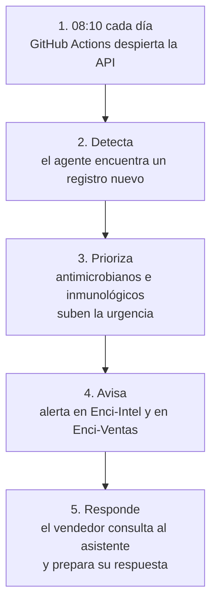
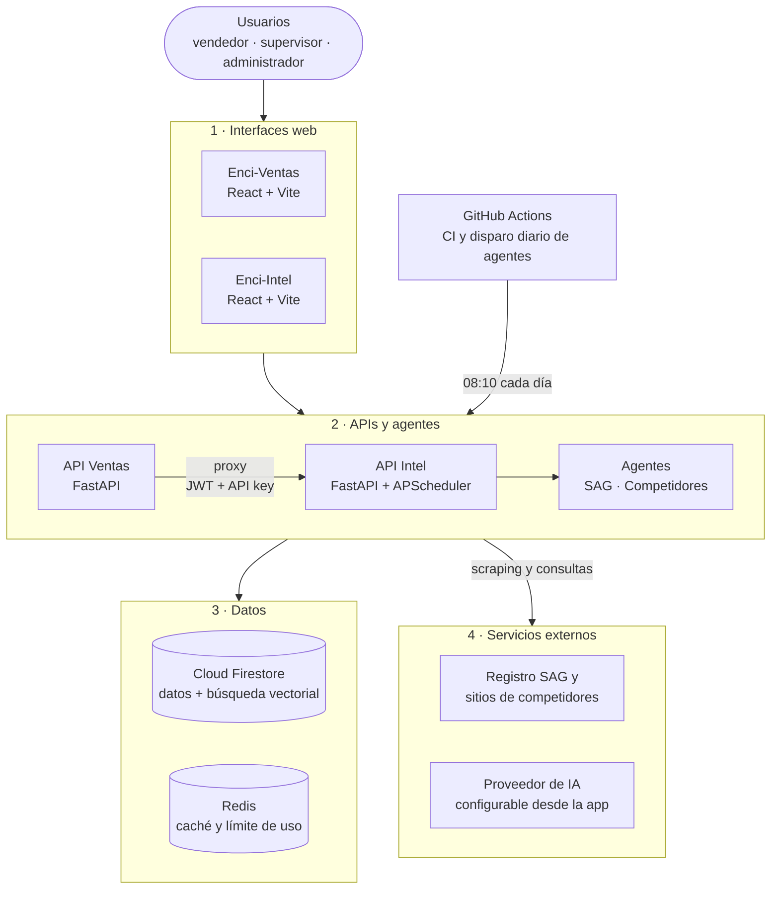

# Enci-Intel · Proyecto Capstone

**Inteligencia de mercado con agentes de IA para Encipharm, integrada al CRM Enci-Ventas.**

Capstone APT122 · Duoc UC, Sede San Joaquín · Ingeniería en Informática · Grupo 1 · 2026
Empresa mandante: **Encipharm** (salud, nutrición y bioseguridad animal) · Docente: Claudia Reinoso Hurtado

---

## ¿Qué es este proyecto?

Encipharm es una empresa chilena con más de 25 años en salud, nutrición y bioseguridad animal. Compite con Zoetis, Virbac, Drag Pharma y Agrovet.

Antes de este proyecto, su equipo comercial seguía a la competencia **a mano, en planillas Excel**: nuevos registros en el SAG, precios y desabastecimientos. Se enteraba de un movimiento entre **1 y 7 días después**.

Esta solución automatiza esa vigilancia:

- **Enci-Intel** revisa cada día el registro del SAG y los sitios de los competidores, y genera alertas con urgencia según la categoría terapéutica.
- **Enci-Ventas** es el CRM de los vendedores y **recibe esas alertas** directamente en su flujo de trabajo.

> **Meta del proyecto:** bajar el *Tiempo de Respuesta Competitiva* (desde que la competencia se mueve hasta que el vendedor lo sabe) de 1–7 días a **menos de 4 horas**.

## Los dos productos

| | Enci-Intel | Enci-Ventas |
|---|---|---|
| **Qué es** | Plataforma de inteligencia de mercado | CRM comercial |
| **Qué hace** | Agentes SAG y Competidores, alertas por urgencia, dashboard con KPIs, consultor veterinario con IA (RAG) | Clientes, oportunidades, propuestas y metas; permisos por rol; auditoría; asistente RAG para el vendedor |
| **Interfaces** | Dashboard web | Web + app móvil del vendedor (Flutter) |
| **Backend** | FastAPI + APScheduler | FastAPI |
| **Frontend** | React + Vite | React + Vite |

Los dos comparten **una sola base de datos: Cloud Firestore**.

## Cómo funciona (caso de uso)



**Actores:** vendedor, supervisor y administrador. **Resultado:** el aviso llega el mismo día, sin revisar planillas.

## Arquitectura



**Cómo leer el diagrama:** el usuario entra por una web, la web habla con su API y las APIs guardan todo en Firestore. Enci-Ventas pide los datos de inteligencia a Enci-Intel mediante un proxy. Los agentes salen a leer el SAG y los sitios de la competencia.

- **Docker Compose:** cada servicio corre en su propio contenedor. Con un solo `docker compose up` se levanta todo, y en local se agregan los emuladores de Firestore y Redis.
- **Seguridad:** todos los endpoints exigen sesión (JWT). Enci-Ventas consume a Enci-Intel con el JWT del usuario más una API key de servicio. El menú y los permisos cambian según el rol.
- **IA confiable:** el asistente RAG responde **solo sobre animales**. Si se le pregunta otra cosa, rechaza con una frase fija.
- **Despliegue en la nube:** webs en **Vercel** y APIs en **Render**. Los agentes corren solos cada mañana.

## Stack tecnológico

| Capa | Tecnología |
|---|---|
| Frontend | React + Vite (Ventas en JavaScript, Intel en TypeScript) |
| App móvil | Flutter (app del vendedor) |
| Backend | Python 3.12 · FastAPI · APScheduler |
| Base de datos | Cloud Firestore con índices vectoriales nativos |
| Caché y rate limit | Redis |
| IA | RAG con proveedor de IA configurable desde la app |
| Pruebas | pytest · Vitest · Playwright · flutter test |
| CI/CD | GitHub Actions |
| Contenedores | Docker y Docker Compose |
| Despliegue | Vercel (webs) y Render (APIs) |

## Estructura del repositorio

```text
Proyecto-Capstone/
├── Fase1/   Diagnóstico y definición del proyecto
├── Fase2/   Desarrollo: código fuente, base de datos y documentación técnica
├── Fase3/   Cierre: diarios de reflexión y presentación final
└── README.md
```

El **código fuente** está en `Fase2/Evidencias Proyecto/Evidencias de Sistema/Aplicacion/Encipharm/`:

```text
Encipharm/
├── Enci-Ventas/
│   ├── Backend/               API FastAPI (app/, tests/, scripts/)
│   ├── frontend/              CRM web React + Vite
│   ├── vendedor_app_flutter/  App móvil del vendedor
│   ├── e2e/                   Pruebas de punta a punta (Playwright)
│   └── docs/                  Documentación técnica de Ventas
├── Enci-Intel/
│   ├── Backend/               API FastAPI, agentes (agents/), RAG, tests/, scripts/
│   └── Frontend/              Dashboard React + Vite
├── docs/                      Revisiones y planes técnicos
├── .github/workflows/         ci.yml (pruebas) y agentes.yml (disparo diario)
├── docker-compose.yml         Levanta todo el proyecto
└── .env.example               Plantilla de variables de entorno
```

## Cómo levantarlo en local

**Requisitos:** Docker y Docker Compose.

```bash
cd "Fase2/Evidencias Proyecto/Evidencias de Sistema/Aplicacion/Encipharm"
cp .env.example .env          # completar los valores (ver abajo)
docker compose up -d --build
```

| Servicio | Dirección |
|---|---|
| Enci-Ventas (web) | http://localhost:5173 |
| Enci-Ventas (API) | http://localhost:8000/health |
| Enci-Intel (web) | http://localhost:5174 |
| Enci-Intel (API y documentación) | http://localhost:8080/docs |

En local, Docker levanta además los **emuladores de Firestore y Redis**, así que no necesitas cuentas en la nube para probar.

### Variables de entorno principales

| Variable | Para qué sirve |
|---|---|
| `APP_ENV` | `development` en local. Sin esto el backend arranca como producción (sin `/docs`). |
| `FIREBASE_PROJECT_ID` | Proyecto de Firestore (en local sirve cualquier id con el emulador). |
| `FIRESTORE_EMULATOR_HOST` | Dirección del emulador de Firestore en local. |
| `FIREBASE_CREDENTIALS_PATH` / `FIREBASE_CREDENTIALS_JSON` | Cuenta de servicio, solo en la nube. **Nunca subir a git.** |
| `JWT_SECRET` | Clave de las sesiones. Usar un valor largo y aleatorio. |
| `ENCI_INTEL_API_URL` y `ENCI_INTEL_API_KEY` | Conexión de Ventas con Intel. La clave debe coincidir con `INTEL_SERVICE_API_KEY` de Intel. |
| `REDIS_URL` | Caché y límite de uso. |
| `DEEPSEEK_API_KEY` / `GEMINI_API_KEY` | Claves del proveedor de IA. |
| `CORS_ORIGINS` | Dominios permitidos (solo los publicados en producción). |

La lista completa está en cada `.env.example`.

### Cargar datos de demostración

Firestore crea las colecciones al escribir el primer documento. Para partir con datos:

```bash
cd Enci-Ventas/Backend            # o Enci-Intel/Backend
uv run python scripts/create_vector_index.py   # índice vectorial del RAG
uv run python scripts/seed_admin.py            # usuario administrador (clave en ADMIN_PASSWORD)
uv run python scripts/seed_demo_sintetico.py   # datos de demostración de Ventas
```

Los datos de demostración son ficticios.

## Calidad y pruebas

| Indicador | Resultado |
|---|---|
| Pruebas automáticas | **+900**, en 5 suites |
| Pruebas de punta a punta (Playwright) | **35** |
| Cobertura del backend de Ventas | **≈ 90 %** (el CI exige un mínimo de 80 %) |
| Hallazgos críticos de la auditoría | **5 de 5 corregidos** |

**Integración continua:** en cada push, GitHub Actions corre un job por área:

1. Enci-Intel backend (pytest con emulador de Firestore)
2. Enci-Ventas backend (pytest, lint y cobertura)
3. Enci-Ventas frontend (lint, tests y build)
4. Enci-Intel frontend (tests y build)

Para correr las pruebas del backend a mano:

```bash
cd Enci-Ventas/Backend && uv run pytest
```

## Evolución del modelo de datos

La empresa pidió dos cambios de base de datos durante el proyecto. Ambos se absorbieron sin romper la API.

| Etapa | Base de datos |
|---|---|
| **Fase 1** · heredado | Google Cloud: Firestore, Cloud Run y Cloud Scheduler |
| **Hito 1** · 29 sep | MVP multi-base: MongoDB Atlas + Supabase (PostgreSQL) + Qdrant + Redis |
| **15–18 oct** · actual | **Cloud Firestore unificado**, a pedido de la empresa. Migración en 72 horas, sin cambiar la API |

Hoy son **21 colecciones** de Ventas (prefijo `ventas_`) más las de Intel, en el mismo proyecto de Firestore. Los índices vectoriales son de 384 dimensiones en Ventas y 2048 en Intel. Los scripts de migración son idempotentes y por defecto corren en modo de prueba; con `--apply` escriben.

## Metodología

Trabajo ágil (Scrum + Kanban) guiado por los hitos de la asignatura:

| Hito | Contenido |
|---|---|
| **S1–S6** | Diagnóstico: 27 hallazgos priorizados P0–P3 |
| **Hito 1** · 29 sep | MVP con base de datos y despliegue público |
| **Migración** · 18 oct | Todo en Cloud Firestore |
| **Hito 2** | Proyecto completo en Docker, con un solo comando |
| **Hito 3** | Pruebas finales, documentación y entrega |

Sprints de 1 a 2 semanas, con revisión y retrospectiva al cierre, y reunión semanal con la docente. Cada hallazgo de auditoría se trabajó como tarea Kanban, con su prueba de regresión.

## Dónde está la documentación

| Quiero… | Ir a |
|---|---|
| Entender la arquitectura vigente | `Fase2/…/Evidencias de Documentacion/01_Arquitectura/Arquitectura_actual.docx` |
| Instalar y poner en marcha | `…/03_Instalacion/` (manual de instalación y guía de incorporación al equipo) |
| Ver los requisitos y sus brechas | `…/02_Requisitos/Plan_integracion_requisitos_ERS.docx` |
| Ver la calidad y las revisiones de código | `…/04_Calidad_y_revisiones/` |
| Ver la migración a Firestore y los cambios | `…/05_Gestion_y_cambios/` (la **v3** es la definición final con la Carta Gantt vigente) |
| Ver las capturas de evidencia | `…/07_Capturas_de_evidencias/` |
| Entender el modelo de datos | `Fase2/…/Evidencias de Sistema/Base de Datos/` (diccionario, diagramas y scripts) |
| Ver el diagnóstico y la definición inicial | `Fase1/` |
| Ver los diarios y el cierre | `Fase3/` |

> **Documentos con información anterior.** Algunos documentos conservan la etapa en que se escribieron y mencionan MongoDB, PostgreSQL o Supabase (por ejemplo `ONBOARDING.md`, `Enci-Ventas/docs/architecture.md` y `Arquitectura_Enci-Ventas_etapa_PostgreSQL.docx`). Se mantienen como evidencia histórica. Para el estado actual, usar `Arquitectura_actual.docx` y este README.

## Equipo

| Integrante | Foco |
|---|---|
| Felipe Ramos | Desarrollo de software (backend) |
| Benjamín Pumarino | Integración de sistemas y APIs / Aseguramiento de la calidad |
| Elías Sánchez | Análisis de datos e IA aplicada |

**Mandante:** Encipharm. Relación gestionada por Alloxentric.
**Docente:** Claudia Reinoso Hurtado.

## Competencias del perfil de egreso evidenciadas

Pruebas de certificación · Gestión de proyectos · Modelos de datos · Solución de software.
